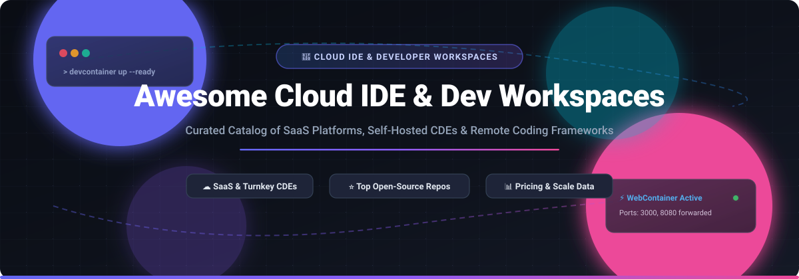

# ☁️ Awesome Cloud IDE & Developer Workspace

  

  
  
  
  
  
  

---

## 🚀 Top Cloud IDE & Developer Workspace Ecosystem

> ⚡ **A curated directory of SaaS platforms, self-hosted Cloud Development Environments (CDEs), open-source browser IDEs, and remote development workspace infrastructure.**

*Focused on Browser-Based Coding Environments, Ephemeral Workspaces, DevContainers, and AI-Augmented Cloud Development.*  
**Last updated: March 2026**

This repository tracks the leading **commercial SaaS platforms** and **open-source GitHub projects** powering modern **Cloud IDEs and Developer Workspaces**. These platforms eliminate the *"works on my machine"* problem by providing complete, ephemeral, and reproducible development runtimes accessible directly through any browser, WebAssembly/WebContainer runtime, or thin client—featuring integrated terminals, code editors, language servers, persistent storage, and AI agents.

---

## 📑 Table of Contents

- [📈 Sector Overview & Market Dynamics](#-sector-overview--market-dynamics)
- [🏢 SaaS & Hosted Platforms](#-saas--hosted-platforms)
- [🛠️ Open-Source GitHub Projects](#️-open-source-github-projects)
- [🏗️ Architectural Frameworks for Custom Systems](#️-architectural-frameworks-for-custom-systems)
- [🤝 How to Contribute](#-how-to-contribute)
- [💖 Support & Sponsorship](#-support--sponsorship)
- [⭐ Star History](#-star-history)
- [⚠️ Disclaimer](#️-disclaimer)

---

## 📈 Sector Overview & Market Dynamics

The global Cloud IDE & Developer Workspace market is estimated at **$6.8 billion in 2025** and is projected to expand to **$28.4 billion by 2034**, advancing at a compound annual growth rate (CAGR) of **17.2%** driven by distributed engineering teams, instant developer onboarding, and autonomous AI coding agents. 

The sector exhibits **moderate-to-high concentration** at the infrastructure foundation layer (heavily dominated by hyperscalers like Microsoft/GitHub Codespaces and Amazon AWS Cloud9), yet remains **highly fragmented across specialized niches**—where browser WebContainer pioneers (StackBlitz), collaborative AI-native app platforms (Replit), and self-hosted Kubernetes workspace orchestrators (Coder, DevPod) capture distinct enterprise and indie developer workflows.

---

## 🏢 SaaS & Hosted Platforms

| Product | Company Scale (Valuation / Revenue) | Description | Pricing (Starting) | Free Tier / Trial Limits |
|:---|:---|:---|:---|:---|
| **[AWS Cloud9](https://aws.amazon.com/cloud9/)** | **~$2.1T+ Market Cap** (Amazon / AWS: ~$105B+ ARR) | Cloud-based IDE with terminal, debugger, and AWS CLI pre-installed. No extra software charge—billed strictly for underlying compute/storage. | $0.0116/hour (t2.micro EC2 compute; ~$2.05/month for 90 hrs) | **AWS Free Tier (12 months)**: 750 hours/month of t2.micro/t3.micro instances + 30 GB EBS storage for new AWS customers. |
| **[GitHub Codespaces](https://github.com/features/codespaces)** | **~$3.0T+ Market Cap** (Parent: Microsoft / GitHub: ~$2B+ ARR) | Cloud development environments natively integrated into GitHub. Supports `devcontainer.json`, prebuilt environments, and VS Code in browser or desktop. | $0.18/hour (2-core Linux pay-as-you-go beyond free allowance; $0.36/hour for 4-core) | **Free forever**: 120 core-hours/month (~60 hours on 2-core, ~30 hours on 4-core) + 15 GB-month storage; 30-min idle timeout. |
| **[Zoho Code](https://www.zoho.com/)** | **~$12B–$15B Est. Valuation** (~$1.5B ARR) | Cloud development, workflow scripting, and low-code IDE embedded inside the Zoho enterprise suite. | $8.00/user/month (billed annually, Zoho Creator Standard tier) | **15-day free trial**: Unrestricted access to full features without credit card; permanent free tier limited to 1 user, 1 app, and 250 MB storage. |
| **[Replit](https://replit.com/)** | **~$3.0B Valuation** (~$100M+ ARR) | Browser-based collaborative IDE featuring autonomous AI Agents, zero-setup environments, hosting, and managed PostgreSQL databases. | $20.00/month (Core tier; $204/year billed annually) | **Starter (free forever)**: Basic Agent access, daily AI allowance, limited monthly cloud compute credits, and 1 published application. |
| **[StackBlitz](https://stackblitz.com/)** | **~$700M Valuation** (~$20M ARR) | In-browser WebContainer-powered IDE running full Node.js runtimes client-side with near-zero latency and instant boot times. | $25.00/month (Pro tier; $18/month billed annually) | **Personal (free forever)**: Unlimited public projects, core WebContainer browser IDE features, GitHub repo access, and 1 MB file upload limit. |
| **[Projector](https://www.jetbrains.com/projector/)** | **~$700M–$800M Annual Revenue** (JetBrains, bootstrapped) | JetBrains' remote-rendering technology to run Swing and IntelliJ-based IDEs on remote Linux servers via web browser. | $79.00/year (WebStorm individual license; or $299/year for All Products Pack) | **30-day free trial**: Full unrestricted access to JetBrains IDEs without feature throttling; Projector server/client components are free open-source software. |
| **[Gitpod](https://www.gitpod.io/)** | **~$100M–$200M Est. Valuation** ($41M funding; ~$8.6M ARR) | Automated ephemeral developer environments supporting devcontainers, prebuilds, and multi-IDE interfaces (VS Code, JetBrains). | $20.00/month (Core tier supporting hosted compute and multi-IDE) | **Free forever**: 500 workspace credits/month (~up to 50 hours of compute), standard workspace classes, and GitHub/GitLab integration. |
| **[CodeSandbox](https://codesandbox.io/)** | **~$51M Valuation** (Acquired by Together AI; $15.2M funding) | Cloud development platform combining fast client sandboxes with remote microVM-based containerized workspaces. | $12.00/month (Pro tier; $9/month billed annually) | **Free forever**: 400 monthly VM credits (~40 hours on Nano VM), up to 20 sandbox repositories per workspace; static sandboxes do not consume credits. |
| **[Eclipse Theia](https://theia-ide.org/)** | **Non-profit Foundation** (~€13M annual budget; Eclipse Foundation) | Open-source, vendor-neutral IDE platform running both in browser and desktop, with managed cloud distributions from ecosystem partners. | $20.00/user/month (commercial managed hosting/support offerings from partners like TypeFox) | **Free forever**: 100% free open-source Eclipse Public License (EPL-2.0) software for self-hosting with no user caps. |
| **[Codeanywhere](https://codeanywhere.com/)** | **~$1M–$3M Est. Valuation** ($813K funding; ~$1.5M ARR) | Cloud development environment providing containerized Linux workspaces with built-in AI completion, terminal, and git integration. | $9.60/month (Basic tier, billed annually; or $12/month billed monthly) | **Free forever**: 4 vCPU, 8 GB RAM, 100 GB storage, 500K AI tokens, 20 hours SGRAM, and 1 parallel workspace (15-min inactivity timeout). |

---

## 🛠️ Open-Source GitHub Projects

Curated list of the top active open-source repositories for self-hosted cloud IDEs, remote developer workspace servers, and browser-based coding frameworks. **Sorted in descending order by GitHub_Stars:**

| Project | GitHub_Stars | Description |
|:---|:---|:---|
| **[code-server](https://github.com/coder/code-server)** |  | Run VS Code on any remote server, virtual machine, or Docker container, accessible directly via any web browser. Self-hosted alternative to GitHub Codespaces with full extension and terminal support. |
| **[Daytona](https://github.com/daytonaio/daytona)** |  | Open-source development environment manager and Cloud Development Environment (CDE) platform that automates provisioning isolated, standardized developer workspaces with a single command. |
| **[Eclipse Theia](https://github.com/eclipse-theia/theia)** |  | Vendor-neutral, extensible IDE framework for desktop and cloud. Built in TypeScript, natively supports the Language Server Protocol (LSP) and VS Code extensions; acts as the foundation for enterprise CDEs. |
| **[Coder](https://github.com/coder/coder)** |  | Enterprise-grade self-hosted Cloud Development Environment (CDE) platform. Uses Terraform to provision secure developer workspaces on your own Kubernetes clusters, Docker hosts, or cloud infrastructure. |
| **[JupyterLab](https://github.com/jupyterlab/jupyterlab)** |  | Web-based interactive development environment for notebooks, code, and data science workflows. Extensible architecture widely deployed in cloud and remote research environments. |
| **[DevPod](https://github.com/loft-sh/devpod)** |  | Client-only, open-source Codespaces alternative. Unifies devcontainers across any cloud provider (AWS, GCP, Azure, DigitalOcean) or local Kubernetes/Docker setup without requiring a centralized daemon. |
| **[Gitpod Core](https://github.com/gitpod-io/gitpod)** |  | Automated developer environment platform that orchestrates ready-to-code ephemeral workspaces in the cloud directly from Git repositories and devcontainer configurations. |
| **[Jupyter Notebook](https://github.com/jupyter/notebook)** |  | The classic interactive computing notebook interface running server-side in the browser, supporting reproducible data workflows, live code execution, and visualizations. |
| **[Eclipse Che](https://github.com/eclipse-che/che)** |  | Kubernetes-native cloud development environment and workspace server. Provides in-browser VS Code-like editors backed by isolated container runtimes with enterprise team management. |
| **[OpenVSCode Server](https://github.com/gitpod-io/openvscode-server)** |  | Upstream VS Code adapted to run smoothly on a remote server and rendered in the browser. Maintained with minimal delta to upstream VS Code; serves as the editor backbone for Gitpod and custom CDEs. |
| **[RStudio Desktop & Server](https://github.com/rstudio/rstudio)** |  | Premier integrated development environment for R and Python, featuring a web-accessible server edition for remote data analytics, interactive visualization, and statistical modeling. |
| **[Docker Webtop](https://github.com/linuxserver/docker-webtop)** |  | Ubuntu/Alpine container providing full desktop GUIs (XFCE, KDE, MATE, i3) accessible via web browser using RDP/webRTC, enabling full IDEs and desktop developer tools inside a remote browser tab. |
| **[Dev Containers CLI](https://github.com/devcontainers/cli)** |  | Reference open-source CLI implementation of the Development Containers Specification (`devcontainer.json`), the industry standard powering Codespaces, DevPod, and remote workspaces. |
| **[Projector Server](https://github.com/JetBrains/projector-server)** |  | JetBrains library for running Swing applications and IntelliJ-based IDEs headlessly on server hardware while streaming drawing commands to web browser clients over WebSockets. |

---

## 🏗️ Architectural Frameworks for Custom Systems

Platform engineering teams building enterprise-grade, self-hosted Cloud Development Environments can combine these modular open-source layers:

1. **Editor / UI Layer**: [code-server](https://github.com/coder/code-server) or [OpenVSCode Server](https://github.com/gitpod-io/openvscode-server) for browser VS Code; [Eclipse Theia](https://github.com/eclipse-theia/theia) for deeply customizable proprietary IDEs.
2. **Environment Specification**: [Dev Containers CLI](https://github.com/devcontainers/cli) via `devcontainer.json` to guarantee reproducible developer configurations.
3. **Workspace Orchestration**: [Coder](https://github.com/coder/coder), [DevPod](https://github.com/loft-sh/devpod), or [Eclipse Che](https://github.com/eclipse-che/che) for provisioning compute, managing container lifecycles, and auto-pausing idle resources on Kubernetes or bare-metal clouds.

---

## 🤝 How to Contribute

Contributions are welcome and appreciated! Help keep this ecosystem guide updated:

1. 🍴 Fork the repository.
2. 🌿 Create a feature branch: `git checkout -b add-my-tool`.
3. ✏️ Add your entry to [README.md](README.md) following the existing tabular structure (ensure factual pricing and official documentation links).
4. 🚀 Open a Pull Request with a concise summary of the addition or update.

---

## 💖 Support & Sponsorship

If you find this curated ecosystem guide valuable for your platform engineering research, team workspace setups, or cloud development workflows, please consider supporting the project:

- ⭐ **Star this repository** to help other developers and DevOps teams discover it!
- 🍴 **Fork and share** with colleagues building remote developer environments.
- ☕ **Buy a coffee & sponsor ongoing maintenance:**  
    
  *Support via the [GitHub Sponsor Dashboard](https://github.com/sponsors/ishandutta2007) directly powers continuous curation, accuracy updates, and open developer resources.*

---

## 📊 Star History

---

## ⚠️ Disclaimer

- This is an independent, **community-curated** catalog — not an endorsement of any commercial platform or vendor.
- Cloud IDEs execute arbitrary user code and expose root terminal sessions; always enforce mutual TLS, zero-trust network isolation, and workspace auto-stop rules to mitigate unexpected billing or resource exhaustion.
- Core-hour quotas (such as GitHub Codespaces) deplete faster on multi-core VMs; configuring 15–30 minute idle timeouts is strongly recommended.

---

  <b>Built with ❤️ for platform engineers, DevOps teams, and cloud developers everywhere.</b>

